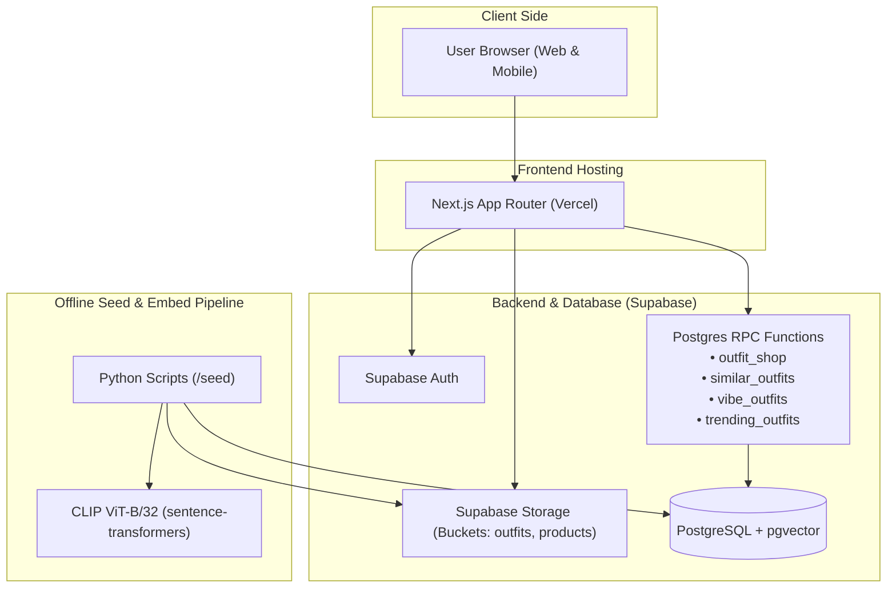

# ThriftTheLook

> Turn any outfit photo into a shoppable look at thrift, mid, and premium budgets, for Indian shoppers (prices in ₹).

[](https://nextjs.org/)
[](https://tailwindcss.com/)
[](https://supabase.com/)
[](https://github.com/openai/CLIP)

---

## 🔗 Demo

- **Live Site**: *[Coming Soon / Add your Vercel deployment URL here]*
- **Video Walkthrough**: *[Coming Soon / Add your Loom or YouTube demo link here]*

---

## ✨ Features

- **Shop the Look at 3 Budgets**: Every outfit is broken into individual garment pieces (top, outerwear, bottom, shoes, bag), with matching product recommendations across three price tiers: **Thrift**, **Mid**, and **Premium** in Indian Rupees (₹).
- **Visual Similarity Search**: Discover visually similar outfits powered by high-dimensional CLIP vector embeddings and cosine distance in `pgvector`.
- **Shop by Vibe**: Browse curated style aesthetics (e.g. *Y2K*, *Minimalist*, *Streetwear*, *Cottagecore*) powered by semantic text-to-image CLIP matching.
- **Trending Outfits**: Discover the most saved looks over the past 7 days.
- **Personal Boards**: Save and curate your favorite outfits to your profile board with persistent Supabase authentication.
- **Outfit Uploads**: Upload your own style inspirations directly to Supabase Storage with automatic database cataloging.

---

## 🧠 How It Works

1. **CLIP Embeddings & pgvector**: Outfits and products are embedded using OpenAI's `clip-ViT-B-32` model into 512-dimensional vector representations stored inside PostgreSQL using the `pgvector` extension.
2. **Outfit Decomposition**: Seed outfits from Fashionpedia are partitioned into individual garment pieces using bounding-box annotations.
3. **Multi-Tier Product Matching (`outfit_shop`)**: For each detected piece, a PostgreSQL RPC function computes cosine similarity against cataloged products within each budget tier (`thrift`, `mid`, `premium`), returning the top match for each tier.
4. **Vibe Discovery (`vibe_outfits`)**: Vibe descriptions are embedded as 512-dimensional text vectors. The system computes the cosine similarity between the vibe text embedding and all outfit image embeddings to surface matching styles.

---

## 🏗️ Architecture



---

## 🛠️ Tech Stack

- **Framework**: [Next.js (App Router)](https://nextjs.org/) + [React 19](https://react.dev/)
- **Language**: [TypeScript](https://www.typescriptlang.org/)
- **Styling**: [Tailwind CSS](https://tailwindcss.com/)
- **Backend & Database**: [Supabase](https://supabase.com/)
  - PostgreSQL database with `pgvector` extension
  - Supabase Auth (Email & Password)
  - Supabase Storage (Buckets: `outfits`, `products`)
  - Stored Procedures & Vector Similarity Functions (RPC)
- **Machine Learning & Embeddings**:
  - Python 3.10+
  - [sentence-transformers](https://sbert.net/) (`clip-ViT-B-32`, 512 dimensions)
  - [Pillow (PIL)](https://python-pillow.org/)
  - [Hugging Face Datasets](https://huggingface.co/docs/datasets)

---

## 📊 Data

- **Outfits**: 50 fashion outfits sourced from the [Fashionpedia dataset](https://fashionpedia.github.io/home/) (train split).
- **Products**: 72 demo products created from Fashionpedia validation split garment crops, assigned fictional store brands and realistic price distributions across thrift, mid, and premium tiers in ₹.

---

## 🚀 Local Setup

### Prerequisites
- Node.js 18.18+ or 20+
- Python 3.10+
- A Supabase project with `pgvector` enabled

### 1. Web Application Setup

```bash
# Clone the repository
git clone https://github.com/annasidney/Thrift-the-look.git
cd thrift-the-look

# Install dependencies
npm install

# Set up environment variables
cp .env.example .env.local
```

Fill in `.env.local` with your Supabase credentials:
```env
NEXT_PUBLIC_SUPABASE_URL=your_supabase_project_url
NEXT_PUBLIC_SUPABASE_ANON_KEY=your_supabase_anon_key
```

Run the development server:
```bash
npm run dev
```

Open [http://localhost:3000](http://localhost:3000) in your browser.

---

### 2. Python Seed & Embed Pipeline (Optional / Database Init)

If initializing the database from scratch:

```powershell
# Navigate to seed directory
cd seed

# Create and activate virtual environment (Windows PowerShell)
python -m venv venv
.\venv\Scripts\Activate.ps1

# Install requirements
pip install datasets supabase sentence-transformers pillow python-dotenv

# Copy env template and set credentials
cp .env.example .env
```

Configure `seed/.env`:
```env
SUPABASE_URL=your_supabase_project_url
SUPABASE_SERVICE_KEY=your_supabase_service_role_key
OWNER_USER_ID=your_supabase_auth_user_id
```

Run the seed scripts in this exact order:
1. `python seed.py` — Seeds 50 Fashionpedia train outfits into the `outfits` table and storage.
2. `python embed.py` — Computes 512-dim CLIP embeddings for all outfits.
3. `python auto_products.py` — Crops val-split garments, generates ₹ prices and store metadata, and populates `products`.
4. `python make_pieces.py` — Crops individual garment pieces from the 50 outfits and embeds them in `pieces`.
5. `python embed_vibes.py` — Embeds 16 vibe style prompts and registers them in `vibes`.

---

## 🗺️ Roadmap

- [ ] **Automated Garment Segmentation for Uploads**: Run an object detection model (e.g. YOLO / Mask R-CNN) on user-uploaded outfits to automatically detect and crop pieces on upload.
- [ ] **Real Product Catalog & Affiliate Links**: Partner with Indian thrift platforms, homegrown labels, and e-commerce stores (Myntra, Ajio, Tata Cliq Luxury).
- [ ] **Natural Language Vibe Search**: Allow users to type free-form queries (e.g., *"monsoon rainy day cozy coffee run"*) and search via real-time CLIP text embedding.

---

## 📜 Credits & License

- **Dataset**: [Fashionpedia dataset](https://fashionpedia.github.io/home/) (Jia et al., 2020), licensed under [CC BY 4.0](https://creativecommons.org/licenses/by/4.0/). Derived image crops are used under the terms of this license.
- **Codebase**: MIT License.
